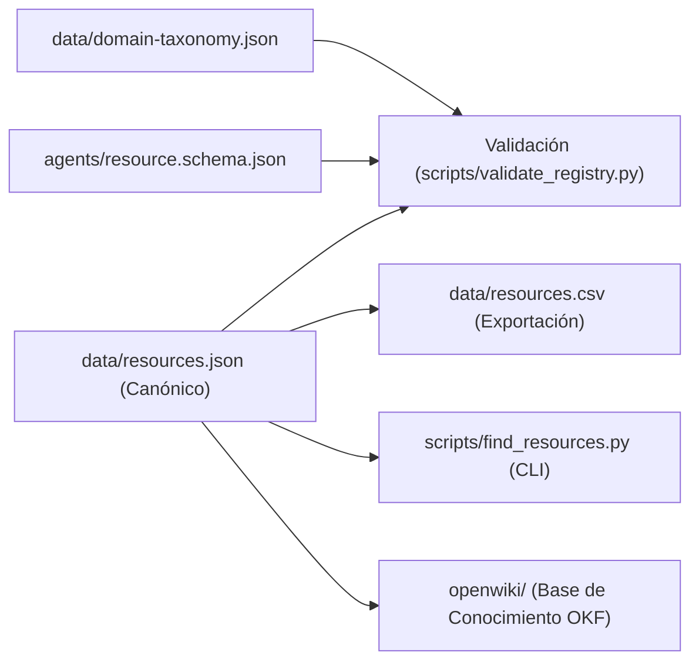

# Arquitectura y Modelo de Datos

Network Atlas separa estrictamente el almacenamiento canónico estructurado de las vistas de presentación y consulta.

## 1. Fuentes Canónicas de Verdad

- **`data/resources.json`**: Fuente primaria y canónica que contiene el array de objetos de recursos. Todo recurso añadido o modificado debe existir aquí con identificadores únicos.
- **`data/resources.csv`**: Vista tabular aplanada derivada de `resources.json`, optimizada para lectura en hojas de cálculo y análisis con pandas/R.
- **`data/domain-taxonomy.json`**: Definición taxonómica formal de categorías primarias, modelos de red, entornos, bandas de escala y estados de verificación.
- **`agents/resource.schema.json`**: Esquema JSON (Draft-07) estricto utilizado para validar la integridad del catálogo.



---

## 2. Esquema Formal del Recurso (`resource.schema.json`)

Cada registro en `resources.json` implementa las siguientes propiedades:

| Campo | Tipo | Obligatorio | Descripción |
|---|---|:---:|---|
| `id` | `string` | Sí | Identificador kebab-case único (ej. `gephi`, `networkx`, `sigma-js`). |
| `name` | `string` | Sí | Nombre oficial del software, biblioteca o dataset. |
| `primary_category` | `string` | Sí | Identificador de categoría definido en `domain-taxonomy.json`. |
| `secondary_categories` | `array[string]` | No | Categorías adicionales aplicables. |
| `network_types` | `array[string]` | Sí | Modelos soportados: `static`, `temporal`, `multilayer`, `hypergraph`, `bipartite`, `directed`, `weighted`. |
| `scale_band` | `string` | Sí | Capacidad de escala: `small_in_memory`, `medium_single_node`, `large_gpu_or_disk`, `scale_distributed`. |
| `environments` | `array[string]` | Sí | Entornos: `python`, `r`, `javascript`, `web`, `desktop_gui`, `cli`, `c_cpp`, `gpu`. |
| `description` | `string` | Sí | Resumen conciso de la funcionalidad central. |
| `primary_url` | `string` | Sí | URL canónica de documentación o repositorio oficial. |
| `source_url` | `string` | No | Repositorio de código fuente (si difiere de `primary_url`). |
| `license` | `string` | No | Licencia de software (ej. `GPL-3.0`, `MIT`, `Apache-2.0`, `Proprietary`). |
| `verification_status` | `string` | Sí | `verified`, `provisional`, `needs_link_resolution`. |

---

## 3. Protocolo de Validación Continua

Para garantizar que no ingresen registros incompletos o taxonomías inválidas:

```bash
python scripts/validate_registry.py
```

El script verifica:
1. Unicidad de todos los `id`.
2. Coincidencia estricta de `primary_category` con `domain-taxonomy.json`.
3. Presencia de campos obligatorios.
4. Identificación de recursos con enlaces pendientes de resolución.

---

## Páginas Relacionadas
- [Taxonomía y Dimensiones](taxonomy-and-dimensions.md)
- [Herramientas CLI y Scripts](../tools/cli-and-automation.md)
- [Índice Maestro OpenWiki](../index.md)
