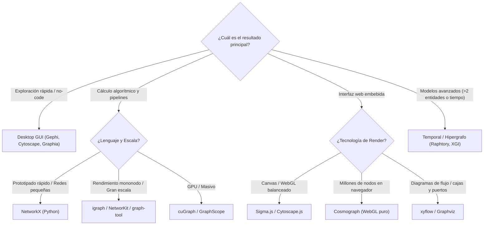

# Framework de Decisión y Criterios de Selección

El núcleo de Network Atlas es un sistema de decisión para transformar una necesidad técnica en una terna o cuarteto de opciones fundamentadas.

## 1. Árbol de Selección en 3 Pasos

---

## 2. Preguntas Obligatorias de Selección

Antes de adoptar cualquier herramienta o emitir una recomendación definitiva:

1. **Definición de Entidad y Enlace:**
   - ¿Qué es un nodo? ¿Qué cuenta exactamente como una arista legítima?
   - Si se proyecta una red bipartita a monopartita, ¿se conservan los pesos y atributos originales?
2. **Modelo Estructural:**
   - ¿Hay marcas de tiempo continuas o eventos instantáneos? Si se agrega en snapshots estáticos, ¿se pierde causalidad o precedencia?
   - ¿Las relaciones son por pares o colectivas (coautoría, hiperaristas)?
3. **Escala Real vs Teórica:**
   - ¿Cuántos nodos y aristas tiene el dataset en producción?
   - ¿El cuello de botella es la memoria RAM, el algoritmo de centralidad o la tasa de refresco (FPS) del navegador?
4. **Restricciones Duras y Seguridad:**
   - ¿Los datos pueden residir en nubes públicas de terceros (SaaS) o deben permanecer *on-premise*?
   - ¿Qué licencia de software se exige (MIT/Apache vs GPL/Comercial)?

---

## 3. Matriz Buy vs Build (Comprar vs Construir)

| Criterio | Cuándo Construir (Build con Open Source) | Cuándo Comprar / Usar SaaS (Buy) |
|---|---|---|
| **Diferenciación de Negocio** | El algoritmo de grafo o el layout es la ventaja competitiva central del producto. | La visualización de redes es una funcionalidad secundaria o accesoria de monitoreo. |
| **Gobernanza y Privacidad** | Datos altamente regulados (salud, banca, defensa) que no pueden salir de VPC local. | Datos públicos o sin restricciones de cumplimiento donde se valora la colaboración remota. |
| **Capacidad del Equipo** | Ingenieros con experiencia en WebGL, grafos, shaders y matemáticas de optimización. | Equipo enfocado en el dominio de negocio que no puede costear el mantenimiento de un motor de render. |
| **Costo Total (TCO)** | Soluciones consolidadas (`Sigma.js`, `NetworkX`) sin costes por asiento/servidor. | Plataformas comerciales (`Bloom`, `KeyLines`, `Linkurious`) si el tiempo a producción es crítico. |

---

## Páginas Relacionadas
- [Guía Rápida y Enrutamiento](../quickstart.md)
- [Evaluación y Benchmarking](evaluation-and-benchmarking.md)
- [Taxonomía y Dimensiones](taxonomy-and-dimensions.md)
