# Network Atlas - OpenWiki Knowledge Base

Bienvenido a la fuente de verdad estructurada de **Network Atlas**. Esta base de conocimiento documenta las herramientas, bibliotecas, datasets, formatos y metodologías para el estudio y visualización de redes complejas.

```mermaid
graph TD
    A["Network Atlas (OpenWiki)"] --> B["Conceptos y Metodología"]
    A --> C["Catálogo de Recursos (97+)"]
    A --> D["Herramientas CLI y Esquemas"]
    A --> E["Gobernanza y Políticas"]

    B --> B1["Arquitectura y Datos"]
    B --> B2["Taxonomía y Dimensiones"]
    B --> B3["Framework de Decisión"]
    B --> B4["Evaluación y Benchmarking"]

    C --> C1["Exploración GUI / Desktop"]
    C --> C2["Visualización Web"]
    C --> C3["Análisis en Python"]
    C --> C4["Análisis en R y Estadística"]
    C --> C5["Escala, GPU y Distribuido"]
    C --> C6["Temporal y Orden Superior"]
    C --> C7["Bases de Datos de Grafos"]
    C --> C8["Datasets y Benchmarks"]
    C --> C9["Formatos e Interoperabilidad"]

    D --> D1["CLI scripts/find_resources.py"]
    D --> D2["resource.schema.json"]
    D --> D3["Protocolo de Routing"]

    E --> E1["Políticas de Licencias"]
    E --> E2["Guía de Contribución"]
```

---

## 1. Entrada Rápida
- [Guía Rápida y Enrutamiento (Quickstart)](quickstart.md) - Resuelva dudas en 30 segundos con tablas de atajos.
- [Registro de Cambios del Wiki (Logs)](logs.md) - Historial de actualizaciones y versiones.

---

## 2. Conceptos Fundamentales
- [Arquitectura y Modelo de Datos](concepts/architecture-and-data-model.md): Esquema formal, validadores, `resources.json` y `resources.csv`.
- [Taxonomía y Dimensiones](concepts/taxonomy-and-dimensions.md): Categorías primarias, modelos de grafos (estáticos, temporales, hipergrafos), entornos y bandas de escala.
- [Framework de Decisión y Criterios](concepts/decision-framework.md): Árbol de decisiones, matriz de *Build vs Buy*, y preguntas de selección obligatorias.
- [Evaluación y Benchmarking](concepts/evaluation-and-benchmarking.md): Metodología rigurosa para evaluar memoria pico, latencia, rendering y fidelidad topológica.

---

## 3. Catálogo Especializado por Dominio
- [Exploración Desktop y GUIs](catalog/desktop-and-gui.md): Gephi, Cytoscape, Graphia, Tulip, VOSviewer.
- [Bibliotecas de Visualización Web](catalog/web-visualization.md): Sigma.js, Cytoscape.js, Cosmograph, G6, Force Graph, xyflow.
- [Análisis de Redes en Python](catalog/python-analysis.md): NetworkX, igraph, NetworKit, graph-tool, SNAP.
- [Análisis y Estadística en R](catalog/r-and-statistics.md): igraph (R), tidygraph, ggraph, statnet, ndtv.
- [Computación a Escala, GPU y Distribuida](catalog/scale-gpu-distributed.md): RAPIDS cuGraph, GraphScope, DGL, PyG.
- [Redes Temporales y de Orden Superior](catalog/temporal-and-higher-order.md): Raphtory, pathpy, XGI, HyperNetX.
- [Bases de Datos de Grafos y Consultas](catalog/graph-databases-and-query.md): Neo4j, Memgraph, Kùzu, Apache AGE.
- [Datasets, Benchmarks y Repositorios](catalog/datasets-and-benchmarks.md): SNAP, OGB, Network Repository, OpenAlex.
- [Formatos e Interoperabilidad](catalog/formats-and-interoperability.md): GraphML, GEXF, JSON-Graph, CSV/TSV, Parquet.

---

## 4. Herramientas y Automatización
- [Herramientas CLI y Scripts de Consulta](tools/cli-and-automation.md): Uso del buscador rápido, filtrado y validación de esquema.
- [Protocolo de Enrutamiento para Agentes (`RESOURCE_ROUTING.md`)](../agents/RESOURCE_ROUTING.md): Guía de inferencia y consultas para agentes LLM.
- [Esquema JSON Canónico (`resource.schema.json`)](../agents/resource.schema.json): Validación estricta para ingestión de recursos.

---

## 5. Gobernanza y Contribución
- [Políticas de Contribución y Gobernanza](governance/policies-and-contribution.md): Flujo de PRs, verificación de enlaces, criterios de inclusión y directrices de licencias.
